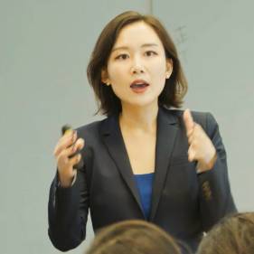
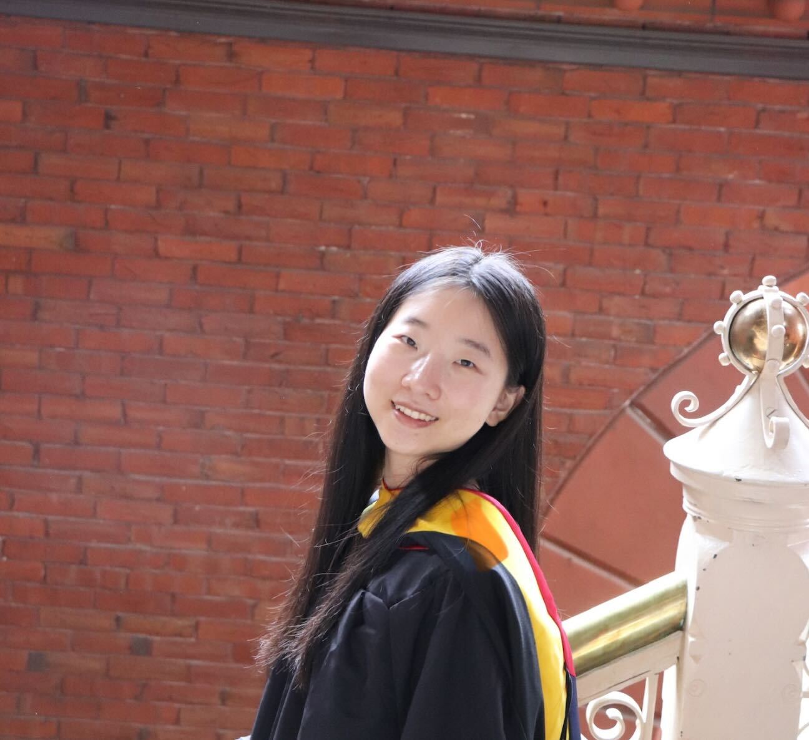
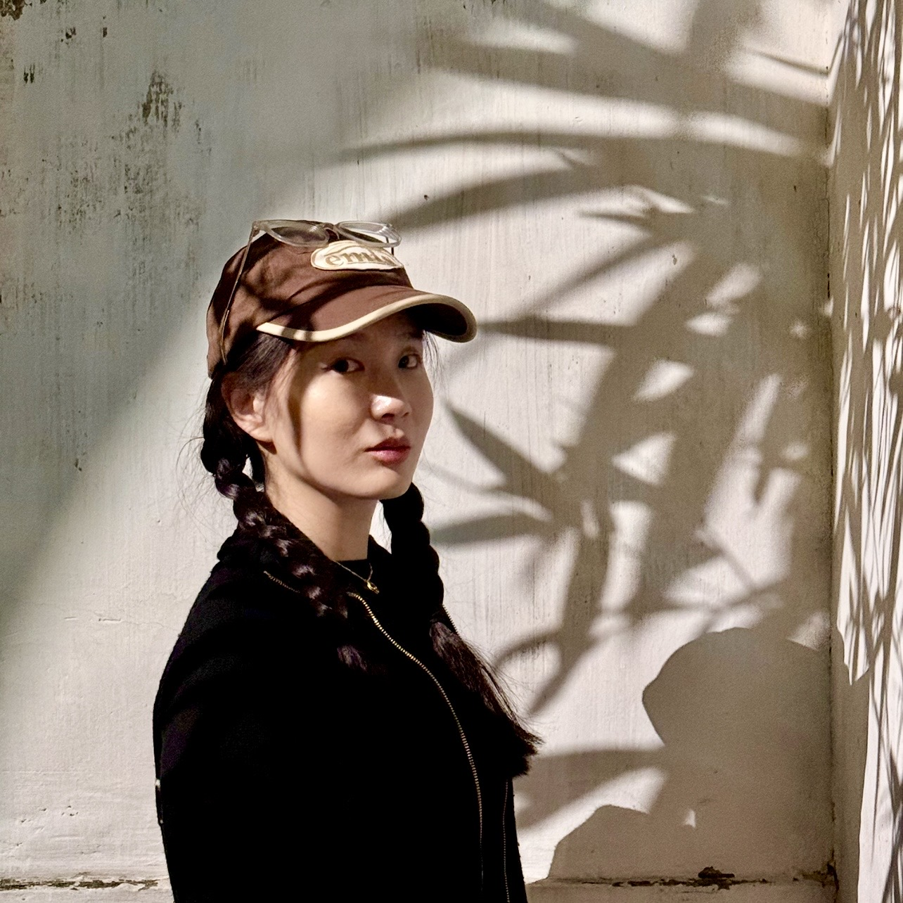
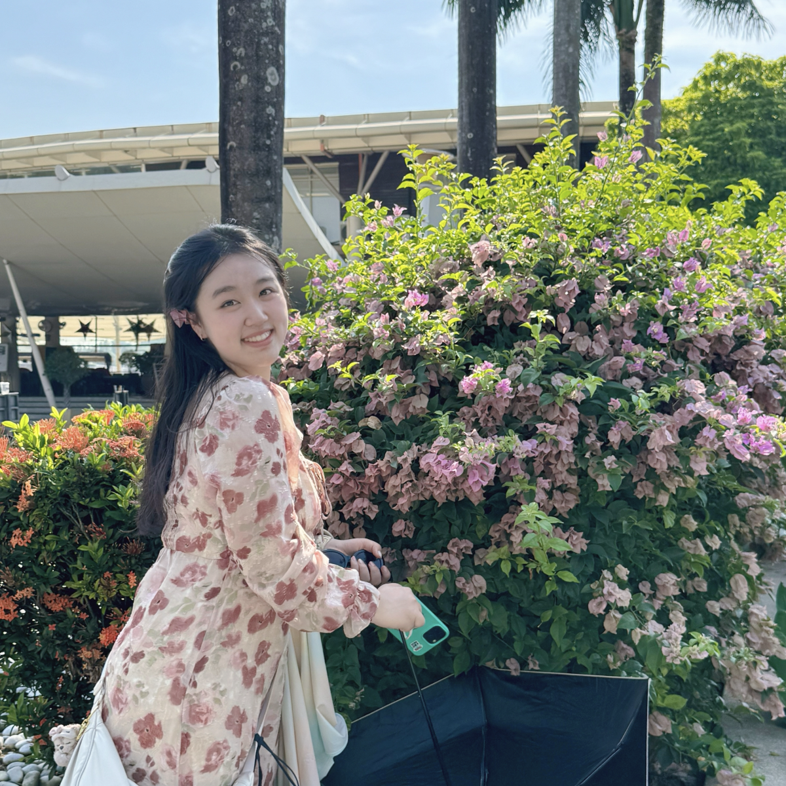
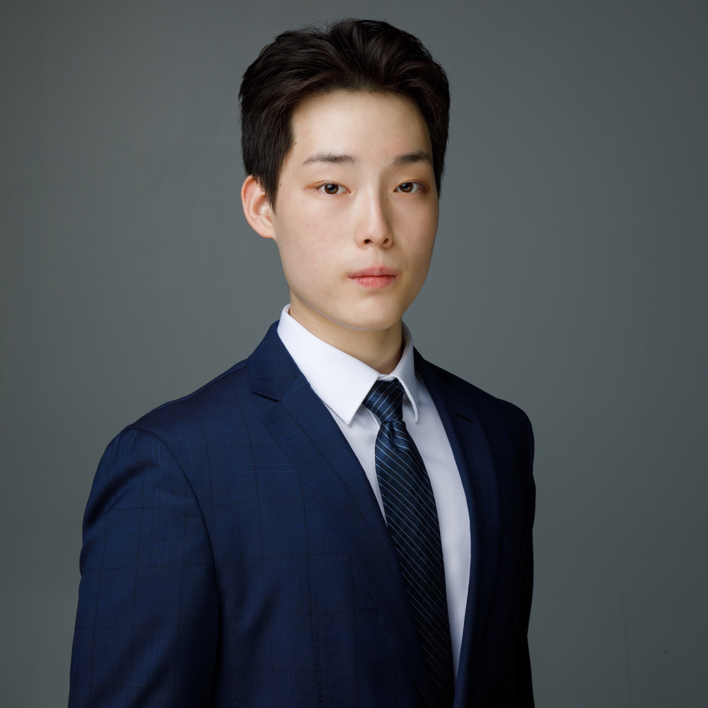

<b>In GIM Lab (Goals, Incentives, &amp; Meritocracy)</b>, we examine how individuals’ motivation and cognition are shaped, or biased, by environmental factors, including rewards, social comparison, and organizational decisions, employing a multi-method approach with field studies, laboratory experiments, and archival data.

<nav class="section-nav" aria-label="Lab sections"><a href="#lab-members">Lab Members</a><a href="#alumni">Alumni</a><a href="#research-opportunities">Research Opportunities</a></nav>

<h2 class="section-title" id="lab-members">Lab Members</h2>

<h3>Principal Investigator</h3>

    
    

        
<b>Julia Hur</b> is an Associate Professor at NYU, NYU Shanghai, and NYU Stern School of Business. She is the PI of GIM Lab.

         
        <a href="https://www.linkedin.com/in/juliadhur/" target="_blank" rel="noopener noreferrer">  LinkedIn Profile </a>
         
          Email: julia.hur [at] nyu [dot] edu 
    

<!-- add this section for Lab manager. -->
<!-- <h2 align="left-top">Lab Manager</h2>

    
    

        
<b>Hattey Ruoming Sun</b> is an incoming PhD Student at Stanford Graduate Business School. He is the current lab manager of GIM Lab.

     
    <a href="https://www.linkedin.com/in/jun-lin-5a9131181/" target="_blank" rel="noopener noreferrer">  LinkedIn Profile </a>
     
      Email: junjtlin [at] gmail [dot] com 
    

-->

<h3>Current Members</h3>

    
    

        
<b>Nan (Jennifer) Dong</b> is a Ph.D. student in Theatre and Performance at the Graduate Center at City University of New York and an adjunct lecturer at Hunter College. Based in New York and Shanghai, she is a dance-maker, artistic producer, and researcher. Her interdisciplinary research is related to motivation and fairness in arts organizations and the creative industry. Deeply believing in arts, she aims to make positive social impacts and foster community dialogue in an intercultural context.

         
        <a href="https://www.linkedin.com/in/jennifernandong" target="_blank" rel="noopener noreferrer">
            LinkedIn Profile </a>
         
          Email: ndong [at] gc [dot] cuny [dot] edu 
    

    
    

        
<b>Minyue Fan</b> received her B.S. and M.S. in Statistics and Machine Learning from Carnegie Mellon University. Her research examines how workplace evaluation systems, including hiring screens, performance ratings and promotion criteria, disadvantage neurodivergent employees by treating cognitive difference as underperformance. At the GIM Lab, she studies how incentives, social comparison and decision structures produce this kind of hidden discrimination, and what organizations can measure instead. Outside of research, she enjoys travel, photography, and cooking.

         
        <a href="https://www.linkedin.com/in/minyf/" target="_blank" rel="noopener noreferrer">
            LinkedIn Profile </a>
         
          Email: minyf42 [at] gmail [dot] com 
    

    
    

        
<b>Tongke Wang</b> is a master's student in the Behavioral and Decision Sciences program at the University of Pennsylvania. She studied Finance, Psychology, and Physics at The Ohio State University. She's interested in exploring the field of financial markets and investors’ decision-making.

         
          Email: tongkew [at] sas [dot] upenn [dot] edu 
    

    
    

        
<b>Wanning (Victoria) Fu</b> received her B.S. in Business & Finance from NYU Shanghai and her M.A. in East Asian Studies from Stanford University. Her research interests broadly center on decision-making under uncertainty, judgment, and behavioral research. She is particularly interested in understanding how incentives and emerging technologies shape individual and organizational decision-making through interdisciplinary empirical and computational approaches.

         
        <a href="https://www.linkedin.com/in/wanningfu/" target="_blank" rel="noopener noreferrer">
            LinkedIn Profile </a>
         
          Email: wf539 [at] nyu [dot] edu 
    

    
    

        
<b>Zhuoer (Melissa) Miao</b> is an undergraduate at NYU Shanghai, Class of 2027, studying Business and Marketing. Her research interests lie at the intersection of management, marketing, and social psychology, with a particular focus on behavioral decision-making, motivation, and judgment. She is especially interested in understanding how incentives, social contexts, and choice environments shape individual and organizational decisions, and in using empirical and data-driven approaches to study these questions.

         
        <a href="https://www.linkedin.com/in/%E5%80%AC%E5%B0%94-%E8%8B%97-624597316?utm_source=share&utm_campaign=share_via&utm_content=profile&utm_medium=ios_app" target="_blank" rel="noopener noreferrer">
            LinkedIn Profile </a>
         
          Email: zm2527 [at] nyu [dot] edu 
    

    
    

        
<b>Vincent Liao</b> is a senior at NYU, Class of 2027, studying Economics with a minor in Business. His research interests include decision-making under uncertainty, consumer behavior, and negotiations, with a particular focus on how incentives and information environments shape judgment in financial markets. At GIM Lab he has worked on survey and experimental datasets in behavioral finance. Outside of academics, he plays volleyball, listens to music, and follows Tottenham Hotspur.

         
        <a href="https://www.linkedin.com/in/vincent--liao/" target="_blank" rel="noopener noreferrer">
            LinkedIn Profile </a>
         
          Email: vl2384 [at] stern [dot] nyu [dot] edu 
    

    
    

        
<b>Oscar Cui</b> is a junior at NYU, Class of 2028, studying Economics. His research interests include consumer behavior and decision-making. Outside of academics, Oscar competes on NYU’s varsity fencing team and enjoys traveling and exploring different cuisines.

         
        <a href="https://www.linkedin.com/in/oscarcui" target="_blank" rel="noopener noreferrer">
            LinkedIn Profile </a>
         
          Email: bc3796 [at] nyu [dot] edu 
    

    
    

        
<b>Ellie Chen</b> is a junior at NYU's Gallatin School of Individualized Study, Class of 2028, studying the Intersection of Healthcare and Business. Her research interests include management and organizational decision-making. Outside of academics, she enjoys playing various sports, traveling, and curating playlists.

         
        <a href="https://www.linkedin.com/in/ellie-c-b18aa12b1/" target="_blank" rel="noopener noreferrer">
            LinkedIn Profile </a>
         
          Email: ec4713 [at] nyu [dot] edu 
    

    
    

        
<b>Zhihan (Tony) Xu</b> is an undergraduate student (Class of 2028) at NYU Shanghai, majoring in Business and Finance with a minor in Economics. Driven by his focus on entrepreneurial markets, he recognized the pivotal role of "people" in business, which shaped his research interests in organizational decision-making, leadership, and incentive mechanisms. He aims to address real-world business challenges using rigorous scientific methods. Outside of research, Tony enjoys reading, playing tennis, and refining his culinary skills.

         
        <a href="https://www.linkedin.com/in/zhihanxutony" target="_blank" rel="noopener noreferrer">
            LinkedIn Profile </a>
         
          Email: zx1995 [at] nyu [dot] edu 
    

<h2 class="section-title" id="alumni">Alumni</h2>

<h3>Academia</h3>
* Jun (Jack) Lin (Stanford GSB, PhD)
* Linhui Wu (University of Minnesota, PhD)
* Letian Kong (CUHK, PhD)
* Yumeng (Skyler) Chen (UC Berkeley, PhD)
* Shawn Fan (University of Toronto, PhD)
* Hattey Sun (CUHK, PhD)
* Elaine Young (UC San Diego, PhD)
* Yang Huang (Columbia University, PhD)
* Crystal Wu (CU Boulder, PhD)
* Xi Yu (Georgia Tech, PhD)
* Youyou Shi (Southeast University, PhD)
* Qichuan Zhou (University of Michigan, PhD)
* Zixuan Zhang (Kyoto University, PhD)
* Sylvia Wu (London Business School, MA)
* Yixiao Han (Johns Hopkins - Tsinghua, Dual MA)
* Eva Hu (NUS, MA)
* Jerry Liu (NYU Stern/ Shanghai, MA)
* Ruiqi Xue (Columbia U, MA)
* Tian Jin (Cornell Tech, MS)

<h3>Industry</h3>

* Ethan Lan (Visa)
* Alger Lin (KPMG)
* Jess Wang (PwC)
* Cynthia Zhou (ByteDance)
* Jingjing Huang (Ctrip/ Trip.com)
* Justin Goldman (Cushman & Wakefield)
* Shanshan Hu (NYU)
* Xu Han (Amazon)
* Daiana Chen (Santander Bank)
* Larry Li (Generation Lab)
* Ming Xian (State Street)
* Shirley Zhang (Boston Consulting Group)
* Chris Lao (Apple)
* Kristall Yuejiao Qiu (Capital One)
* Arya Li (Garena)
* Khloe Jargalsaikhan (PwC Mongolia)

<h2 class="section-title" id="research-opportunities">Research Opportunities</h2>

Interested in research? We welcome applications from undergraduate and Master's students to come work with us! We are looking for hard-working and sociable research assistants. Please email the GIM lab PI, <b>Julia Hur (julia.hur [at] nyu [dot] edu)</b> to see if there is any available opportunity. Please send your resume or CV in your email.

